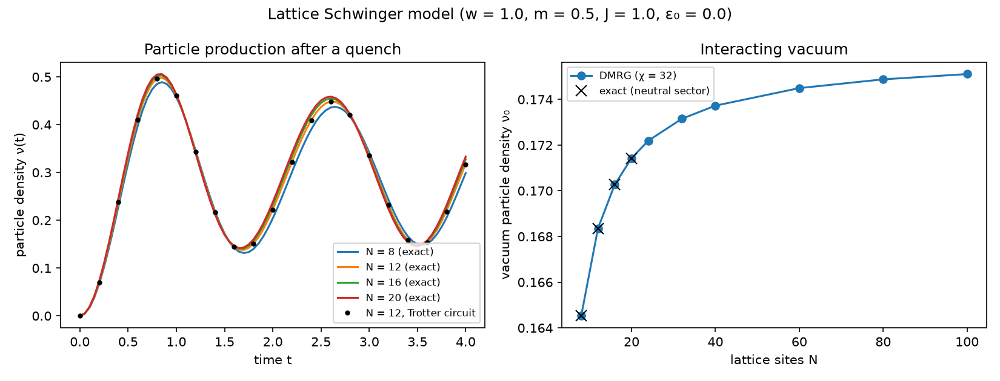

<div align="center">

# ketrs

**A fast quantum computer simulator in Rust, with Python bindings, Vulkan GPU acceleration, and Qiskit / OpenQASM 3 support.**

[](https://github.com/Aethar01/ketrs/actions/workflows/ci.yml)
[](https://aethar01.github.io/ketrs/)
[](https://pypi.org/project/ketrs/)
[](https://crates.io/crates/ketrs)
[](https://docs.rs/ketrs)
[](https://pypi.org/project/ketrs/)
[](#license)

[Docs](https://aethar01.github.io/ketrs/) · [Install](#install) · [Quick Start](#quick-start) · [Choosing an Engine](#choosing-an-engine) · [Recipes](#recipes) · [Example](#example-lattice-schwinger-model) · [Benchmarks](#benchmarks) · [Development](#development)

</div>

---

`ketrs` is built for researchers and developers who want high-speed quantum circuit and many-body simulation without heavy runtime toolchains:

- **Fast out of the box:** 3–9× faster than Qiskit Aer on CPU statevectors, 18–460× faster on mid-circuit measurement circuits, 6–32× faster on MPS TEBD, and faster than The Walrus, Piquasso, Perceval, QuTiP, and Bosonic Qiskit across continuous-variable (qumode) and hybrid workloads.
- **Vendor-neutral GPU support:** runs on NVIDIA, AMD, Intel, and Apple Silicon GPUs through Vulkan 1.2 (and MoltenVK on macOS, up to 31 qubits, plus GPU MPS sweeps, CV Fock statevectors, and permanents). No CUDA or ROCm install needed.
- **Qubits, qumodes & hybrids:** exact statevectors, density matrices, symmetry sectors, open & periodic MPS on hundreds of qubits (DMRG, TDVP, TEBD, conserved `U(1)` / `Zₙ` charges), a full continuous-variable suite (`GaussianState`, `GaussianMixture`, `FixedNFockState`, `FockState`, `BosonicMps`, `WindowSampler`, exact GBS & boson samplers, automatic `plan_circuit`), and mixed-radix qubit–qumode `HybridState`.
- **Drop-in interop:** convert Qiskit `QuantumCircuit`, `SparsePauliOp`, and Aer `NoiseModel` objects directly, or import/export OpenQASM 3.

---

## Install

### Python

```sh
pip install ketrs              # Python 3.10+ (including free-threaded 3.14t)
pip install "ketrs[qiskit]"    # includes Qiskit converter support
```

Prebuilt wheels are published for **Linux** (x86-64, arm64, glibc 2.28+), **Windows** (x86-64), and **macOS** (Apple Silicon).
- All prebuilt wheels ship with `GpuStatevector` enabled: Linux and Windows use the system Vulkan driver, and macOS wheels bundle MoltenVK (single precision, `complex64`, as Apple GPUs lack native 64-bit floats).
- On other platforms, `pip` builds from source (requires Rust 1.88+).

### Rust

```sh
cargo add ketrs                 # CPU engines
cargo add ketrs --features gpu  # adds GpuStatevector and GPU-accelerated MPS sweeps
```

---

## Quick Start

### Python

Build a 2-qubit Bell state, inspect probabilities, sample shots, and measure an expectation value:

```python
import ketrs

# Build a circuit (methods return the circuit so calls chain)
bell = ketrs.Circuit(2).h(0).cx(0, 1)

# Simulate from |00⟩
state = ketrs.Statevector.from_circuit(bell, seed=42)

print(state.probabilities())       # [0.5 0.  0.  0.5]
print(state.sample_counts(1000))   # {'00': ~500, '11': ~500}
print(state.expectation("ZZ"))     # 1.0
```

### Rust

```rust
use ketrs::{Circuit, PauliSum, Statevector};

fn main() {
    let mut bell = Circuit::new(2);
    bell.h(0).cx(0, 1);

    let state = Statevector::from_circuit(&bell);
    let probs = state.probabilities(); // [0.5, 0.0, 0.0, 0.5]

    let zz = PauliSum::from_list([("ZZ", 1.0)]).unwrap();
    let exp = state.expectation(&zz).unwrap(); // 1.0
    println!("probs={probs:?}, <ZZ>={exp}");
}
```

> **Qubit ordering convention (matches Qiskit):** Qubit `0` is the **least significant bit** of basis-state indices and the **rightmost** character in bitstrings and Pauli labels.
> - Bitstring `"10"` means `q1 = 1, q0 = 0` (basis index `2`).
> - Pauli label `"XZ"` means `X` on `q1` and `Z` on `q0`.

---

## Choosing an Engine

All engines share the same `Circuit` and `PauliSum` types, so you can prototype on a `Statevector` and scale up with minimal code changes.

| What you need | Engine | Highlights & scale |
|---|---|---|
| **Exact circuits (CPU)** | `Statevector` | Parallel, cache-blocked, gate-fused. Pass `dtype="real"` (half memory for real circuits), `"complex64"`, or `"float32"` (1.65× / 4× faster at 22–26 qubits, ~10⁻⁶ accuracy). In Rust: `Statevector`, `RealStatevector`, `Statevector32`, `RealStatevector32`. |
| **Large exact circuits (GPU)** | `GpuStatevector` | Any Vulkan 1.2 GPU (NVIDIA, AMD, Intel, Apple Silicon via MoltenVK), up to 31 qubits. Double (`"complex128"`) or single (`"complex64"`, 2.8–5.8× faster on consumer cards) precision. Runs gates, expectations, sampling, `apply_pauli_sum`, adjoint gradients, and exact `exp(-iHt)` on GPU. |
| **Fixed particle / spin / charge** | `SectorStatevector` | Stores only basis states matching fixed Hamming-weight constraints (`SectorBasis`), rejecting any operation that leaves the sector. |
| **Noise & mixed states** | `DensityMatrix` | Exact Kraus channels (depolarizing, amplitude/phase damping, Pauli, custom) and per-gate `NoiseModel`s (matches Qiskit Aer and runs 1.3–4.2× faster). For larger qubit counts, run the same `NoiseModel` (plus readout error) on `Statevector` as quantum trajectories. |
| **Many-qubit open chains** | `MPS` | Weakly entangled states of hundreds of qubits. TEBD, TDVP (any Hamiltonian range, with global subspace expansion), DMRG (with noise to avoid local traps), sampling, post-selection (`project`), batched `expectations`, conserved `U(1)`/`Zₙ` charges (`with_charges`), and optional Vulkan FP64 GPU sweeps (`mps.gpu = True`). |
| **Many-qubit closed rings** | `PeriodicMPS` | Periodic-trace MPS on closed rings with direct `(n-1, 0)` seam gates, Pippan–White–Evertz compressed periodic DMRG, time-reversible periodic TDVP, TEBD, conserved `U(1)`/`Zₙ` charges, and optional Vulkan FP64 GPU sweeps. |

---

## Recipes

Copy-pasteable snippets for the most common workflows.

### 1. Run a Qiskit circuit or OpenQASM 3 program

```python
import ketrs
from ketrs.qiskit import from_qiskit, pauli_sum_from_qiskit
from qiskit import QuantumCircuit

qc = QuantumCircuit(3)
qc.h(0)
qc.cx(0, 1)
qc.cx(1, 2)

circ = from_qiskit(qc)
state = ketrs.Statevector.from_circuit(circ)
print(state.expectation("ZZZ"))  # 0.0
print(state.expectation("XXX"))  # 1.0
```

`from_qiskit` preserves parametric circuits, `PauliEvolutionGate`s (applied directly as native Pauli rotations), multi-controlled gates (`ccx`, `mcx`, `cswap`, …), measurements, resets, and dynamic control flow (`if_test`, `while_loop`, `for_loop`, `store`), automatically decomposing any other custom gate through its Qiskit definition.

OpenQASM 3 and 2 work out of the box too:

```python
circ = ketrs.from_qasm("""
OPENQASM 3.0;
include "stdgates.inc";
qubit[2] q;
h q[0];
cx q[0], q[1];
""")
print(circ.to_qasm())  # exports standard OpenQASM 3 readable by Qiskit's qasm3.loads
```

### 2. Run on a GPU (Vulkan, no CUDA or ROCm needed)

```python
import ketrs

print("Detected GPU:", ketrs.gpu_device())

circ = ketrs.qft(22)
# Use dtype="complex64" for maximum throughput on consumer GPUs,
# or omit dtype to automatically pick the GPU's highest precision.
gpu_state = ketrs.GpuStatevector.from_circuit(circ, dtype="complex64")
print(gpu_state.expectation("I" * 21 + "Z"))
```

### 3. Optimize a circuit

Lossless circuit optimization at levels `0`–`3`, targeting either ketrs's native gate set (`basis="native"`) or `{CX, 1q}` (`basis="cx"`):

```python
import ketrs

H = ketrs.PauliSum([("XXII", 0.5), ("YYII", 0.5), ("IIXX", 0.5), ("IIYY", 0.5), ("ZZZZ", 0.25)])
circ = ketrs.Circuit(4).pauli_evolution(H, time=0.5, steps=2, order=2)

opt = circ.optimize(level=3, basis="cx")
print("2Q depth:", circ.two_qubit_depth(), "->", opt.two_qubit_depth())
print("Gate counts:", opt.gate_counts())
```

### 4. Parametric circuits & VQE adjoint gradients

Compute an expectation value and its exact gradient with respect to every parameter in a single adjoint pass (costing ~2.3–3.5× a forward evaluation regardless of parameter count):

```python
import ketrs

n = 4
ansatz = ketrs.Circuit(n)
theta = ansatz.parameters(n)
for q in range(n):
    ansatz.ry(theta[q], q)
for q in range(n - 1):
    ansatz.cx(q, q + 1)

H = ketrs.PauliSum([("IIZZ", -1.0), ("IZZI", -1.0), ("ZZII", -1.0), ("IIIX", -0.5)])

zero = ketrs.Statevector(n)
energy, grad = zero.expectation_gradient(ansatz, [0.2, 0.4, 0.6, 0.8], H)
print(f"E = {energy:.6f}, dE/dθ = {grad}")
```

Parameters also support affine expressions like `2 * theta[0] + 0.5`, and `Statevector.adjoint_gradient` supports gradients of arbitrary custom losses.

### 5. Hamiltonians, exact time evolution & ground states

Hamiltonians (`PauliSum`) are applied matrix-free, so no sparse matrix needs to be formed:

```python
import ketrs

# 4-qubit transverse-field Ising Hamiltonian
H = ketrs.PauliSum([
    ("IIZZ", -1.0), ("IZZI", -1.0), ("ZZII", -1.0),
    ("IIIX", -0.5), ("IIXI", -0.5), ("IXII", -0.5), ("XIII", -0.5),
])

# Exact matrix-free time evolution exp(-iHt)|ψ⟩ via Krylov
psi = ketrs.Statevector(4)
psi.evolve(H, time=1.5)
print("⟨H⟩ after evolution:", psi.expectation(H))

# Exact lowest eigenstates via matrix-free Lanczos
ground = ketrs.lowest_eigenstates(H, n_qubits=4, k=1)[0]
print(f"Ground energy: {ground.energy:.10f} (residual {ground.residual:.1e})")
```

For systems with conserved particle number or spin, restrict to a `SectorBasis` to slash memory and runtime:

```python
sector = ketrs.SectorBasis(n_qubits=12, constraints=[(range(12), 6)])  # half filling: 924 vs 4096 states
# Solve inside the sector:
# ground = ketrs.lowest_eigenstates(H_conserving, n_qubits=12, k=1, sector=sector)[0]
```

Need a general sparse Hermitian operator that isn't compact as a Pauli sum? Pass a `ketrs.SparseOperator.from_scipy(csr_matrix)` anywhere `Statevector.expectation`, `apply_pauli_sum`, or `evolve` expects a Hamiltonian.

### 6. Noise models & dynamic circuits (mid-circuit measurement)

Run exact noisy density matrices, or quantum trajectories on statevectors for more qubits (including readout error and `ketrs.qiskit.noise_model_from_aer`):

```python
import ketrs

noise = ketrs.NoiseModel(
    one_qubit=ketrs.Channel.depolarizing(0.005, n_qubits=1),
    two_qubit=ketrs.Channel.depolarizing(0.02, n_qubits=2),
    readout=(0.01, 0.02),  # P(read 1 | 0), P(read 0 | 1)
)

bell = ketrs.Circuit(2).h(0).cx(0, 1)

# Exact density matrix
rho = ketrs.DensityMatrix(2)
rho.run_noisy(bell, noise)
ideal = ketrs.Statevector.from_circuit(bell)
print(f"Fidelity: {rho.fidelity(ideal):.4f}, Purity: {rho.purity():.4f}")

# Quantum trajectories with mid-circuit measurement & classical feedback
dyn = ketrs.Circuit(2, 2).h(0).measure(0, 0)
dyn.if_test(0, 1, ketrs.Circuit(2, 2).x(1))
dyn.measure(1, 1)

counts = ketrs.Statevector(2, seed=0).sample_circuit(dyn, shots=1000, noise=noise)
print("Noisy trajectory counts:", counts)
```

Circuits also support `reset`, `while_loop`, `for_loop`, `break_loop`/`continue_loop`, `assign`, and arbitrary classical expressions (`if_expr`) across every engine.

### 7. Many-qubit chains & rings with MPS, DMRG, TDVP & symmetries

Simulate hundreds of weakly entangled qubits with open (`MPS`) or periodic (`PeriodicMPS`) boundary conditions:

```python
import ketrs

n = 40
# Transverse-field Ising chain
terms = []
for i in range(n - 1):
    label = ["I"] * n
    label[n - 1 - i] = label[n - 2 - i] = "Z"
    terms.append(("".join(label), -1.0))
for i in range(n):
    label = ["I"] * n
    label[n - 1 - i] = "X"
    terms.append(("".join(label), -0.5))
H = ketrs.PauliSum(terms)

# Ground state via two-site DMRG
mps = ketrs.MPS.random(n, bond=8, seed=0, max_bond=32)
energy, sweeps, converged = mps.dmrg(H, max_bond=32)
print(f"DMRG energy ({n} qubits): {energy:.8f}, converged={converged}")

# Time evolution via TDVP (works for long-range Hamiltonians too) or TEBD
mps.tdvp(H, time=0.2, steps=2)

# Fast batched local expectations (contracts each string only over its own span)
z_ops = ["I" * (n - 1 - i) + "Z" + "I" * i for i in range(n)]
magnetization = mps.expectations(z_ops)
```

For Hamiltonians with conserved `U(1)` or `Zₙ` charges, turn on block-sparse symmetry sectors (28–137× faster and ~30× less memory in gauge-theory benchmarks), or enable Vulkan FP64 GPU sweeps with `mps.gpu = True`:

```python
# Example: start from a Néel state in the half-filling sector and conserve total particle number
neel = ketrs.Circuit(n)
for q in range(0, n, 2):
    neel.x(q)

charge = ketrs.Charge.weights([1] * n)
sym_mps = ketrs.MPS.from_circuit(neel, max_bond=64).with_charges([charge])
# sym_mps.dmrg(H_conserving, max_bond=64)
# sym_mps.tdvp(H_conserving, time=0.5, steps=5)
```

For periodic rings, swap `ketrs.MPS` for `ketrs.PeriodicMPS`. It supports the same `dmrg`, `tdvp`, `tebd`, `with_charges`, `expectations`, `project`, `sample_counts`, and `gpu = True` workflow.

---

## Example: Lattice Schwinger Model

[`examples/schwinger`](https://github.com/Aethar01/ketrs/tree/main/examples/schwinger) simulates 1+1D quantum electrodynamics (the lattice Schwinger model with all-to-all electric-field interactions) using three of ketrs's engines and cross-checks every result against an independent method:

1. **Quench particle production:** exact Krylov evolution in the charge-neutral `SectorStatevector` (at 20 sites: 184,756 amplitudes instead of 1,048,576), validated against a second-order Trotter circuit on `Statevector`.
2. **Interacting vacuum up to 100 sites:** `MPS.dmrg` (automatic `O(N)` MPO compression of all-to-all `ZZ` couplings), validated to ~10⁻¹¹ against exact sector Lanczos (`lowest_eigenstates`).



```sh
python examples/schwinger/schwinger.py
```

---

## Benchmarks

Headline speedups against Qiskit Aer 0.18 (in its fastest configuration at each size) and SciPy. Reproduce with the scripts in [`bench/`](https://github.com/Aethar01/ketrs/tree/main/bench).

| Benchmark | Hardware | Baseline | ketrs speedup |
|---|---|---|---:|
| **CPU statevector** (18–26q ansatz & QFT) | Ryzen 5 5600X | Qiskit Aer 0.18 CPU | **2.2–9.1×** |
| **GPU statevector, f32** (22–28q ansatz & QFT) | NVIDIA RTX 4090 | Aer 0.18 CUDA | **2.3–4.2×** |
| **GPU statevector, f64** (22–28q ansatz & QFT) | NVIDIA RTX 4090 | Best of Aer CUDA / cuStateVec | **1.7–2.3×** |
| **Mid-circuit measurement** (12–20q, 1000 shots) | Ryzen 5 5600X | Best of Aer / Aer shot-branching | **18–460×** |
| **MPS TEBD** (50–100q, χ = 32–128) | Ryzen 5 5600X | Aer MPS | **6.3–32.5×** |
| **MPS GPU TDVP & DMRG** (64–192q, χ = 64) | RX 9060 XT (Vulkan FP64) | ketrs CPU (3 threads) | **2.7–3.4×** |
| **Symmetric MPS TDVP** (194q gauge theory, χ = 64–256) | Ryzen 5 5600X (6 threads) | ketrs dense GPU (RX 9060 XT) | **28–137×** |
| **Exact `exp(-iHt)` & Lanczos** (14–20q Heisenberg) | Ryzen 5 5600X | SciPy `expm_multiply` / `eigsh` | **2.8–17.0×** |

<details>
<summary><strong>Detailed benchmark tables & methodology</strong> (click to expand)</summary>

Measured on a Ryzen 5 5600X and an AMD RX 9060 XT (through Vulkan), against Qiskit Aer 0.18 in its fastest configuration (passive OpenMP waiting, and fusion on or off, whichever is faster at each size). In the bar charts each block is 1× unless noted.

### Statevector circuits (CPU & AMD Vulkan GPU)

End to end from `|0…0⟩` to the final amplitudes. The GPU column is compared with ketrs on the CPU, not with Aer: Aer's GPU mode needs CUDA, which this card can't run (see below for an NVIDIA card). GPU times are in double precision, which consumer cards run at a fraction of their single-precision speed, and include downloading the state.

*Layered ansatz: 10 layers of Ry rotations and a CNOT chain*

| Qubits | Aer | ketrs | vs Aer | ketrs GPU | GPU vs CPU |
|---:|---:|---:|:---|---:|:---|
| 18 | 37.1 ms | 7.1 ms | `█████▎` 5.2× | 5.5 ms | `█▎` 1.3× |
| 20 | 115.7 ms | 52.3 ms | `██▎` 2.2× | 20.0 ms | `██▋` 2.6× |
| 22 | 736.8 ms | 125.3 ms | `█████▉` 5.9× | 78.3 ms | `█▋` 1.6× |
| 24 | 3.12 s | 555.4 ms | `█████▋` 5.6× | 238.2 ms | `██▍` 2.3× |
| 26 | 13.82 s | 2.42 s | `█████▊` 5.7× | 935.2 ms | `██▋` 2.6× |

*Quantum Fourier transform*

| Qubits | Aer | ketrs | vs Aer | ketrs GPU | GPU vs CPU |
|---:|---:|---:|:---|---:|:---|
| 18 | 18.8 ms | 3.6 ms | `█████▎` 5.2× | 2.6 ms | `█▍` 1.4× |
| 20 | 71.9 ms | 16.1 ms | `████▌` 4.5× | 11.8 ms | `█▍` 1.4× |
| 22 | 236.0 ms | 70.7 ms | `███▍` 3.3× | 40.3 ms | `█▊` 1.8× |
| 24 | 1.33 s | 169.9 ms | `███████▉` 7.8× | 171.6 ms | `█` 1.0× |
| 26 | 6.21 s | 678.7 ms | `█████████▏` 9.1× | 613.0 ms | `█▏` 1.1× |

Against Qiskit's NumPy `quantum_info.Statevector`, ketrs is 29–87× faster at 18–20 qubits. Below 18 qubits the comparison with Aer is dominated by Aer's per-job overhead of about 2 ms, so it is left out.

On the GPU, gates are batched into shared-memory tiles over any set of 10 qubits (11 on NVIDIA), taking gates out of order where they commute, so most of a circuit takes one pass over GPU memory per tile rather than per gate. Expectation values computed on the GPU are 14–15× faster than downloading the state; 29 qubits (8 GiB) runs on a 16 GB card.

### Against Aer on an NVIDIA GPU (RTX 4090)

Rented RTX 4090, against Aer 0.18's CUDA backend at matching precision, and in double precision also with cuStateVec (taking the faster). Times are GPU work only, reading back one `⟨Z⟩`: that host downloaded states at about 1 GB/s for both simulators, which would otherwise dominate. The 4090 runs doubles at 1/64 of its float speed, so single precision is the case it is built for.

| Circuit | Qubits | Aer f32 | ketrs f32 | vs Aer | best Aer f64 | ketrs f64 | vs Aer |
|---|---:|---:|---:|:---|---:|---:|:---|
| Layered | 22 | 37.4 ms | 14.1 ms | `██▋` 2.7× | 32.5 ms | 18.1 ms | `█▊` 1.8× |
| Layered | 24 | 158.5 ms | 45.5 ms | `███▌` 3.5× | 129.5 ms | 56.4 ms | `██▎` 2.3× |
| Layered | 26 | 671.7 ms | 176.7 ms | `███▊` 3.8× | 498.5 ms | 247.3 ms | `██` 2.0× |
| Layered | 28 | 2.86 s | 687.5 ms | `████▏` 4.2× | 2.09 s | 1.02 s | `██` 2.0× |
| QFT | 22 | 25.0 ms | 9.9 ms | `██▌` 2.5× | 21.9 ms | 13.0 ms | `█▋` 1.7× |
| QFT | 24 | 68.0 ms | 27.5 ms | `██▌` 2.5× | 73.2 ms | 43.7 ms | `█▋` 1.7× |
| QFT | 26 | 255.5 ms | 110.0 ms | `██▍` 2.3× | 304.5 ms | 182.3 ms | `█▋` 1.7× |
| QFT | 28 | 1.08 s | 380.7 ms | `██▉` 2.8× | 1.33 s | 720.2 ms | `█▉` 1.8× |

### Mid-circuit measurement

1000 shots of circuits that measure, reset, and branch partway through, ending with every qubit measured. *Feed-forward* is 4 layers of the ansatz above, two measurements with corrections conditioned on them, and 4 more layers; *repeat until success* re-prepares and measures an entangled qubit until it reads 1, then runs 4 more layers. Aer runs with and without its shot branching (off by default), and the faster counts. One block is 20×.

| Circuit | Qubits | Aer | Aer, shot branching | ketrs | vs best Aer |
|---|---:|---:|---:|---:|:---|
| Feed-forward | 12 | 300 ms | 64.2 ms | 896 µs | `███▋` 72× |
| Feed-forward | 16 | 7.63 s | 1.36 s | 7.2 ms | `█████████▌` 189× |
| Feed-forward | 20 | 160.0 s | 31.7 s | 69.0 ms | `███████████████████████` 460× |
| Repeat until success | 12 | 347 ms | 127 ms | 7.0 ms | `▉` 18× |
| Repeat until success | 16 | 7.26 s | 2.24 s | 49.4 ms | `██▎` 45× |
| Repeat until success | 20 | 143.1 s | 45.2 s | 428 ms | `█████▎` 106× |

ketrs follows each distinct measurement history once, splitting the shots between outcomes by binomial draws, and samples the final measurements from each history's state. Most of the gap is that last step: with control flow in a circuit, Aer measures the final qubits shot by shot (or branch by branch) instead of sampling them. The two agree on the counts' distribution.

### MPS TEBD

TEBD of a transverse-field Ising chain (second-order Trotter, Δt = 0.1) against Aer's MPS method with the same bond-dimension cap χ. Commuting Trotter terms are packed into layers and disjoint bonds are updated in parallel. The two agree on `⟨Z⟩` to the truncation level. One block is 2×.

| Qubits | Steps | χ cap | ketrs | Aer MPS | Speedup |
|---:|---:|---:|---:|---:|:---|
| 50 | 10 | 32 | 0.01 s | 0.04 s | `███▏` 6.3× |
| 100 | 10 | 32 | 0.01 s | 0.07 s | `█████▊` 11.5× |
| 50 | 20 | 64 | 0.02 s | 0.18 s | `████▌` 9.0× |
| 100 | 20 | 64 | 0.03 s | 0.38 s | `███████▎` 14.6× |
| 100 | 40 | 128 | 2.33 s | 75.73 s | `████████████████▎` 32.5× |

### MPS on the GPU

With and without `mps.gpu = True` on the RX 9060 XT, at bond dimension cap χ = 64: one two-site TDVP step (Δt = 0.6) of a 192-qubit Schwinger model with link registers (1537 Pauli terms, MPO bond dimension ~25), from a warmed-up state; and six DMRG sweeps from a Néel state for a 64-qubit J₁–J₂ Heisenberg chain (J₂ = 0.2). GPU and CPU reach the same bond dimensions and energies to 10⁻¹⁰. The CPU had three threads (the other three cores were busy). One block is 1×.

| Workload | Mean bond | GPU | CPU, 3 threads | Speedup |
|---|---:|---:|---:|:---|
| TDVP step | 56 | 38.3 s | 130.5 s | `███▍` 3.4× |
| DMRG, 6 sweeps | 50 | 12.2 s | 33.6 s | `██▊` 2.7× |

The GPU applies the effective Hamiltonians (~95% of CPU time) and runs the Krylov and Lanczos recurrences; SVDs and subspace expansion stay on the CPU. Consumer cards run 64-bit floats at a fraction of their 32-bit speed (~400 GFLOP/s here), so the gain depends on the card's FP64 rate and free CPU cores.

### Symmetric MPS

Preparing a wave packet in a 194-qubit Schwinger model with link registers (48 sites, three qubits per link, two packet ancillas): two TDVP steps of a 4032-term generator on the DMRG vacuum, then projecting the packet's ancilla. Symmetric, with the total charge and the 48 Gauss laws as charges (`with_charges`), against dense on the RX 9060 XT (TDVP alone). The charge-graded MPO is 3–4× narrower than the Pauli one, and block-sparse environments take 28–33× less memory (0.14 GB vs 4.1 GB at χ = 256). Packet weight agrees to 10⁻³, within truncation. One block is 8×.

| χ cap | Dense, GPU | Symmetric, 6 threads | Symmetric, GPU | Speedup |
|---:|---:|---:|---:|:---|
| 64 | 33.7 s | 1.2 s | 2.7 s | `███▌` 28× |
| 128 | 199.5 s | 2.6 s | 4.5 s | `█████████▋` 77× |
| 256 | 811 s | 5.9 s | 6.5 s | `█████████████████▏` 137× |

Symmetric blocks are small (at most 40 states here), so on the GPU each Krylov step is a few tens of microseconds between dispatches: it pays off at larger bonds, matching the CPU at χ = 256 and running 1.6× faster at χ = 512 (10.2 s vs 16.4 s). With 402 qubits (100 sites, 101 charges) at χ = 256, an evolution step took 19.2 s on six threads and 14.5 s on the GPU.

### Exact evolution & ground states vs SciPy

Heisenberg chain against SciPy's `expm_multiply` and `eigsh` on a pre-built sparse matrix (construction not timed). Results agree to ~10⁻¹⁴.

| Workload | Qubits | ketrs | SciPy | Speedup |
|---|---:|---:|---:|:---|
| `exp(-iHt)∣ψ⟩` | 14 | 10.4 ms | 28.7 ms | `██▊` 2.8× |
| `exp(-iHt)∣ψ⟩` | 18 | 196.5 ms | 728.7 ms | `███▊` 3.7× |
| `exp(-iHt)∣ψ⟩` | 20 | 732.7 ms | 3.80 s | `█████▏` 5.2× |
| Ground state | 14 | 16.4 ms | 67.8 ms | `████▏` 4.1× |
| Ground state | 18 | 165.7 ms | 2.81 s | `█████████████████` 17.0× |
| Ground state | 20 | 2.74 s | 11.06 s | `████` 4.0× |

At 20 qubits the Pauli-sum table exceeds its 64 MiB budget and ketrs falls back to a slower path, hence the drop.

</details>

---

## Development

```sh
uv venv && uv pip install maturin pytest qiskit qiskit-aer qiskit-qasm3-import numpy scipy
maturin develop --release     # build the Python module (add --features gpu)
cargo test --workspace        # Rust tests (add --all-features for GPU)
pytest                        # Python tests
```

Building with GPU support (`--features gpu`) compiles GLSL compute shaders using `glslc` at build time: install `glslc` / `shaderc` from your package manager (`brew install shaderc molten-vk` on macOS) or the Vulkan SDK, or set `GLSLC=/path/to/glslc`. Running needs only a Vulkan driver (or MoltenVK on macOS, bundled in the macOS Python wheels).

**Status:** Early releases (`0.2.x`); APIs may still evolve. See [CHANGELOG.md](https://github.com/Aethar01/ketrs/blob/main/CHANGELOG.md) for release notes and [docs.rs/ketrs](https://docs.rs/ketrs) for the Rust API reference.

## License

Licensed under either of [Apache-2.0](https://github.com/Aethar01/ketrs/blob/main/LICENSE-APACHE) or [MIT](https://github.com/Aethar01/ketrs/blob/main/LICENSE-MIT), at your option.
