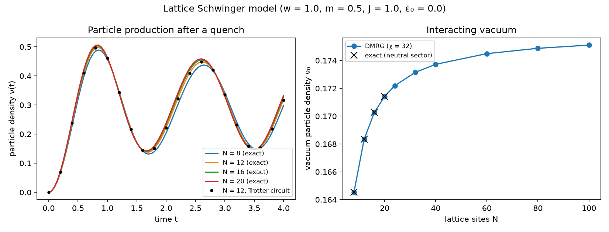

# Example: Lattice Schwinger Model

The Schwinger model is quantum electrodynamics in 1+1 dimensions, a standard testbed for quantum simulation of lattice gauge theories. [`examples/schwinger/schwinger.py`](https://github.com/Aethar01/ketrs/blob/main/examples/schwinger/schwinger.py) simulates its lattice formulation using three of `ketrs`'s engines and validates every result against an independent method.



## The Model

Kogut–Susskind staggered fermions on $N$ sites, Jordan–Wigner mapped to qubits, with the gauge field eliminated via Gauss's law (open boundaries):

$$
\begin{aligned}
H &= \frac{w}{2} \sum_{n=0}^{N-2} (X_n X_{n+1} + Y_n Y_{n+1}) + \frac{m}{2} \sum_{n=0}^{N-1} (-1)^n Z_n + J \sum_{n=0}^{N-2} L_n^2, \\
L_n &= \varepsilon_0 + \frac{1}{2} \sum_{k=0}^{n} \bigl(Z_k + (-1)^k\bigr).
\end{aligned}
$$

Squaring the electric field $L_n$ couples every pair of sites (all-to-all $ZZ$ interactions). $H$ conserves total charge $\sum_n Z_n$; physical states are charge-neutral, which corresponds to the half-filling symmetry sector. In the example script, $w = J = 1$, $m = 0.5$, and $\varepsilon_0 = 0$.

## What the Example Computes

1. **Particle production after a quench (left plot):** Starting from the bare vacuum (no particles), the particle density

    $$
    \nu(t) = \frac{1}{2N} \sum_{n=0}^{N-1} \bigl((-1)^n \langle Z_n \rangle_t + 1\bigr)
    $$

    oscillates as fermion–antifermion pairs are created and annihilated.

    - Solid curves: exact Krylov time evolution (`SectorStatevector.evolve`) inside the neutral sector, which at $N = 20$ stores only $\binom{20}{10} = 184{,}756$ amplitudes instead of $2^{20} = 1{,}048{,}576$.
    - Dots: second-order Trotter circuit (`Circuit.pauli_evolution`) on a full `Statevector`, agreeing with the exact evolution to $10^{-3}$ at $\Delta t = 0.05$.

2. **The interacting vacuum (right plot):** Ground-state particle density as the lattice grows up to 100 sites via `MPS.dmrg` ($\chi = 32$).

    - All-to-all electric terms would naively require an $O(N^2)$ MPO bond dimension; `ketrs`'s MPO builder shares states between terms with common remaining operators, keeping it $O(N)$.
    - Crosses: exact sector Lanczos (`lowest_eigenstates(..., sector=...)`). DMRG energies match to $\sim 10^{-11}$.

## Running It

```sh
python examples/schwinger/schwinger.py
```

Takes about 40 seconds on a Ryzen 5 5600X (most of it the exact $N = 20$ quench); DMRG at $N = 100$ takes about 6 seconds. It prints validation metrics and writes `examples/schwinger/schwinger.png`.
