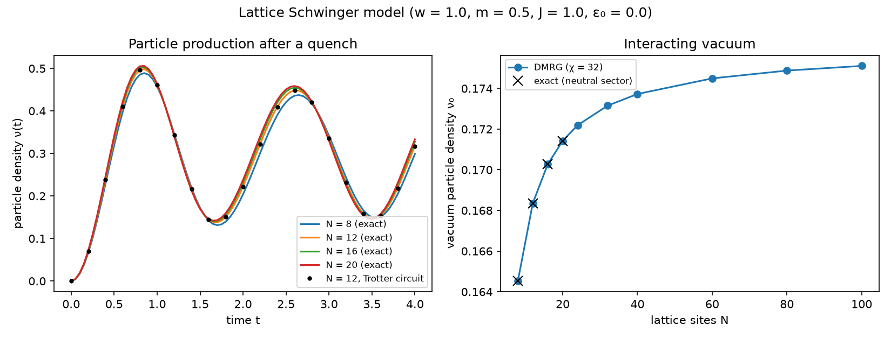

# Lattice Schwinger model

The Schwinger model is quantum electrodynamics in one space dimension, a
standard testbed for quantum simulation of gauge theories. This example
simulates its lattice form with three of ketrs's engines and checks each
result against an independent method.



## Model

Kogut–Susskind staggered fermions on `N` sites, mapped to qubits by
Jordan–Wigner, with the gauge field removed using Gauss's law (open
boundaries):

```
H = w Σₙ (XₙXₙ₊₁ + YₙYₙ₊₁)/2 + (m/2) Σₙ (−1)ⁿ Zₙ + J Σₙ Lₙ²
Lₙ = ε₀ + ½ Σ_{k≤n} (Z_k + (−1)^k)
```

Squaring the electric field `Lₙ` couples every pair of sites (all-to-all
`ZZ` terms). `H` conserves the charge `Σ Zₙ`; physical states are neutral,
which is the half-filling symmetry sector. Here `w = J = 1`, `m = 0.5`,
`ε₀ = 0`.

## What it computes

**Left: particle production after a quench.** Starting from the bare vacuum
(no particles), the particle density `ν(t) = (1/2N) Σ ((−1)ⁿ Zₙ + 1)` oscillates
as pairs are created and annihilated. Curves are exact time evolution
(`SectorStatevector.evolve`, Krylov) within the neutral sector, which at
`N = 20` holds 184,756 amplitudes instead of 1,048,576. The dots are a
second-order Trotter circuit (`Circuit.pauli_evolution`) run on a full
statevector; they agree with the exact result to `1e-3` at `dt = 0.05`.

**Right: the interacting vacuum.** The ground state's particle density as the
lattice grows, by DMRG (`MPS.dmrg`, χ = 32) up to 100 sites. The all-to-all
electric terms would naively need an `O(N²)` MPO bond; ketrs's MPO shares
states between terms with the same remaining operators, which needs only
`O(N)`. Crosses are exact diagonalisation within the neutral sector
(`lowest_eigenstates(..., sector=...)`); DMRG energies match them to about
`1e-11`.

## Running it

```sh
python examples/schwinger/schwinger.py
```

Takes about 40 seconds on a Ryzen 5 5600X (most of it the exact `N = 20`
quench); DMRG at `N = 100` takes about 6 seconds. It prints the validation
numbers above and writes `schwinger.png`.
